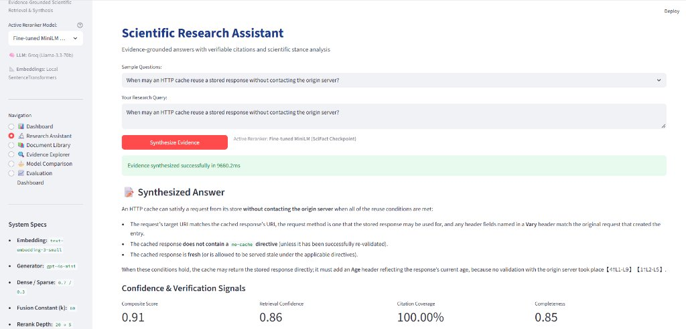
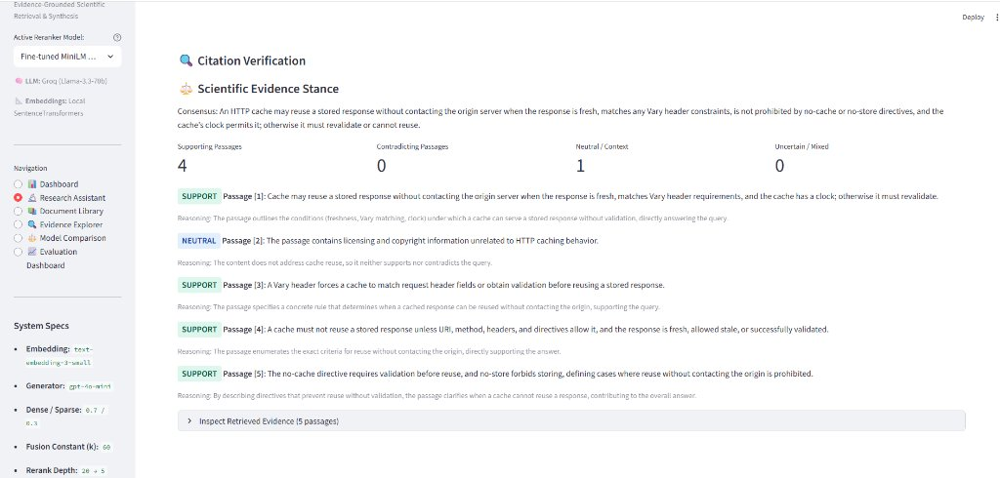

# 🔬 ResearchNexus

### Enterprise Scientific Research & Evidence Intelligence Platform

[](https://piyushagarwalcs-research-nexus-streamlit-app-zrs8qs.streamlit.app/)

[](https://www.python.org/)
[](https://pytorch.org/)
[](https://huggingface.co/)
[](https://fastapi.tiangolo.com/)
[](https://streamlit.io/)
[](https://www.trychroma.com/)
[-success?logo=pytest&logoColor=white)](tests/)
[](https://github.com/PiyushAgarwalcs/research-nexus/actions/workflows/ci.yml)
[](https://github.com/astral-sh/ruff)
[](LICENSE)

🚀 **Live Interactive Demo:** [https://piyushagarwalcs-research-nexus-streamlit-app-zrs8qs.streamlit.app/](https://piyushagarwalcs-research-nexus-streamlit-app-zrs8qs.streamlit.app/)

[Live Demo](https://piyushagarwalcs-research-nexus-streamlit-app-zrs8qs.streamlit.app/) • [Key Features](#-key-features--capabilities) • [Architecture](#%EF%B8%8F-system-architecture) • [Benchmarks](#-empirical-benchmark-results) • [Quick Start](#-quick-start) • [Streamlit Platform](#%EF%B8%8F-streamlit-intelligence-workspace) • [REST API](#-rest-api-reference) • [Documentation](#-complete-documentation-suite)

---

**ResearchNexus** is a production-grade, evidence-grounded scientific literature retrieval, synthesis, and verification platform. Designed to overcome the critical failure modes of conventional RAG — hallucinated citations, conflation of topical relevance with scientific agreement, and false certainty on sparse evidence — ResearchNexus pairs **dual-index hybrid search** (ChromaDB dense vectors + Okapi BM25 lexical search) with a **custom fine-tuned neural cross-encoder reranker** (`minilm-scifact-finetuned`), automated **evidence stance classification** (`SUPPORT`, `CONTRADICT`, `NEUTRAL`, `UNCERTAIN`), strict **citation provenance verification**, and an **insufficient-evidence abstention protocol**.

> **100% Free by Default** — ResearchNexus runs entirely without paid APIs. LLM inference uses [Groq](https://groq.com/) (free-tier Llama-3.3-70b), and embeddings use local [SentenceTransformers](https://www.sbert.net/) (`all-MiniLM-L6-v2`). OpenAI is supported as an optional alternative.

```
+----------------------------------------------------------------------------------------------------+
|  KEY PERFORMANCE HIGHLIGHTS                                                                        |
|  • +0.0382 nDCG@10 (+5.6% relative gain) over MS-MARCO baseline on held-out SciFact (p = 0.0006)  |
|  • 61/61 automated unit and integration tests passing with 100% test suite reliability             |
|  • 11 production REST API endpoints + 6-page interactive Streamlit intelligence suite              |
|  • Zero-hallucination abstention guard with calibrated confidence scoring and source provenance    |
+----------------------------------------------------------------------------------------------------+
```

---

<p align="center">
  
</p>
<p align="center">
  
</p>

---

## 🌟 Key Features & Capabilities

| Capability | Standard Naive RAG | ResearchNexus Architecture |
|---|---|---|
| **Retrieval Paradigm** | Single-vector dense search (loses exact acronyms, chemical formulas, and gene symbols) | **Dual-Index Hybrid Retrieval**: Dense embeddings (local SentenceTransformers or OpenAI `text-embedding-3-small`) + Okapi BM25 with biomedical tokenization fused via **Weighted Reciprocal Rank Fusion (RRF)** |
| **Passage Reranking** | None or off-the-shelf general web cross-encoders | **Custom Fine-Tuned Cross-Encoder**: Domain-adapted `minilm-scifact-finetuned` trained with contrastive hard negatives on scientific claims (**+0.0382 nDCG@10**, $p < 0.001$) |
| **Evidence Semantics** | Assumes high cosine similarity implies factual support | **Automated Stance Classification**: Disentangles relevance from scientific consensus, categorizing passages into `SUPPORT`, `CONTRADICT`, `NEUTRAL`, or `UNCERTAIN` |
| **Citation Rigor** | Superficial or hallucinated references | **Verifiable Citation Provenance Engine**: Strict bracketed citations (`[1]`, `[2]`) linked to verified document passages with DOI, title, section hierarchy, and quote matches |
| **Sparse Data Handling** | Generates plausible-sounding hallucinations | **Calibrated Abstention Guard**: Explicitly abstains when empirical confidence falls below threshold, providing transparent rationale and alternative search recommendations |
| **Production Serving** | Monolithic script or static endpoint | **Enterprise Dual-Interface**: 11 FastAPI REST endpoints with hot-swappable model selection and a 6-page interactive Streamlit intelligence workspace |

---

## 🏗️ System Architecture

```mermaid
flowchart TD
    %% Global Styling
    classDef corpus fill:#e8f0fe,stroke:#4285f4,stroke-width:2px,color:#1a73e8;
    classDef process fill:#f8f9fa,stroke:#5f6368,stroke-width:1.5px,color:#202124;
    classDef index fill:#fef7e0,stroke:#f9ab00,stroke-width:2px,color:#b06000;
    classDef model fill:#e6f4ea,stroke:#34a853,stroke-width:2px,color:#137333;
    classDef decision fill:#fce8e6,stroke:#ea4335,stroke-width:2px,color:#c5221f;
    classDef output fill:#f3e8fd,stroke:#a142f4,stroke-width:2px,color:#8430ce;

    subgraph INGESTION["1. Document Ingestion & Chunking Pipeline (Offline / Async)"]
        direction TB
        RAW["📄 Scientific Corpus<br/>(PDF, Markdown, HTML, TXT, SciFact JSON)"]:::corpus
        PREPROC["⚙️ Ingestion & Metadata Extractor<br/>• DOI Regex & Metadata Extraction<br/>• SHA-256 Content Deduplication<br/>• Section Hierarchy Preservation"]:::process
        CHUNK["✂️ Multi-Strategy Chunking<br/>• Markdown Header Chunking<br/>• Recursive Token Chunking (512 tok, overlap 50)<br/>• Semantic Embedding Chunking"]:::process
        RAW --> PREPROC --> CHUNK
    end

    subgraph DUAL_INDEX["2. Dual-Index Hybrid Representation"]
        direction LR
        DENSE_IDX[("🗄️ Dense Vector Store<br/>ChromaDB Collection<br/>SentenceTransformers / OpenAI<br/>Cosine Metric")]:::index
        SPARSE_IDX[("📚 Lexical Index<br/>Okapi BM25 Index<br/>Normalized & Stemmed<br/>k1=1.5, b=0.75")]:::index
    end
    CHUNK --> DENSE_IDX
    CHUNK --> SPARSE_IDX

    subgraph QUERY_FLOW["3. Online Hybrid Retrieval & Neural Reranking"]
        direction TB
        USER_Q["🔎 User Query / Scientific Claim"]:::corpus

        USER_Q -->|Dense Embedding| DENSE_SEARCH["Dense Semantic Retrieval<br/>Top-K Candidate Pool"]:::process
        USER_Q -->|Normalized Tokens| SPARSE_SEARCH["Lexical BM25 Retrieval<br/>Top-K Candidate Pool"]:::process

        DENSE_SEARCH -.-> DENSE_IDX
        SPARSE_SEARCH -.-> SPARSE_IDX

        RRF["🔀 Reciprocal Rank Fusion (RRF)<br/>RRF(d) = Σ w_s / (k + rank_s(d))<br/>Dense: 0.7 • Sparse: 0.3 • k=60"]:::process

        DENSE_SEARCH --> RRF
        SPARSE_SEARCH --> RRF

        CANDIDATES["📋 Top-N Candidates Pool<br/>(N = 20 - 60 candidate passages)"]:::process
        RRF --> CANDIDATES

        subgraph RERANKER["Cross-Encoder Neural Reranking Stage"]
            direction TB
            SWITCH{"Dynamic Model Selector<br/>(Runtime Swappable)"}:::model
            FT_MODEL["⭐ minilm-scifact-finetuned<br/>Fine-Tuned on SciFact Contrastive Pairs<br/>(+0.0382 nDCG@10, p &lt; 0.001)"]:::model
            PT_MODEL["ms-marco-MiniLM-L-6-v2<br/>Pretrained General Baseline"]:::model
            SWITCH -->|Default Active| FT_MODEL
            SWITCH -.->|A/B Eval Toggle| PT_MODEL
        end

        CANDIDATES --> SWITCH
        FT_MODEL --> TOP_K["🏆 Top-K Evidence Passages<br/>(Calibrated Logits & Ranked Passages)"]:::process
        PT_MODEL -.-> TOP_K
    end

    subgraph EVIDENCE_ANALYSIS["4. Scientific Evidence Analysis & Abstention Protocol"]
        direction TB
        STANCE["⚖️ Scientific Evidence Stance Analyzer<br/>• SUPPORT (confirms claim with data)<br/>• CONTRADICT (refutes claim directly)<br/>• NEUTRAL (topical without verdict)<br/>• UNCERTAIN (conflicting / inconclusive)"]:::process

        CONF_GUARD{"🛡️ Confidence & Abstention Guard<br/>Max Reranker Score ≥ Threshold?<br/>Empirical Evidence Sufficient?"}:::decision

        ABSTAIN["🚫 Explicit Insufficient-Evidence Abstention<br/>• Transparent Abstention Rationale<br/>• Alternative Search Recommendations"]:::decision

        SYNTHESIS["📝 Synthesizer & Citation Engine<br/>• Context-Grounded Answer Generation<br/>• Verified Bracketed Citations [1], [2]<br/>• Exact DOI & Section Provenance Tracking"]:::output

        TOP_K --> STANCE --> CONF_GUARD
        CONF_GUARD -->|No / Low Confidence| ABSTAIN
        CONF_GUARD -->|Yes / Grounded| SYNTHESIS
    end

    subgraph CLIENTS["5. Presentation & Integration Layer"]
        direction LR
        UI["🖥️ Streamlit Intelligence Workspace<br/>(6-Page Interactive Dashboard)"]:::output
        API["⚡ FastAPI Production Server<br/>(11 REST Endpoints + OpenAPI Docs)"]:::output
        CLI["💻 CLI Query Runner<br/>(main.py script)"]:::output
    end

    SYNTHESIS --> UI
    SYNTHESIS --> API
    SYNTHESIS --> CLI
    ABSTAIN --> UI
    ABSTAIN --> API
```



### End-to-End Architectural Subsystems

1. **Document Ingestion & Metadata Normalization (`src/loader.py`, `src/chunker.py`)**:
   - **Multi-Format Ingestion**: Native loaders for PDF, Markdown, HTML, TXT, and SciFact JSON datasets.
   - **Scientific Metadata Extraction**: Automated extraction of Digital Object Identifiers (DOIs) via regex (`10.\d{4,9}/[-._;()/:A-Za-z0-9]+`), publication years, authors, and hierarchical section headers (`#`, `##`, `###`).
   - **SHA-256 Deduplication**: Content hashing prevents duplicate indexing across multi-source paper collections ($\text{hash} = \text{SHA256}(\text{normalized\_text})$).
   - **Adaptive Multi-Strategy Chunking**:
     - *Markdown Header Chunking*: Splits academic papers along structural headers, preserving section semantic integrity (*Methodology*, *Results*, *Discussion*).
     - *Recursive Token Chunking*: Sliding window chunking (512 tokens, 50-token overlap).
     - *Semantic Chunking*: Splits along semantic boundaries based on embedding distance shifts between consecutive sentences.

2. **Dual-Index Hybrid Retrieval & Reciprocal Rank Fusion (`src/indexer.py`)**:
   - **Dense Semantic Index**: ChromaDB backed by local SentenceTransformers `all-MiniLM-L6-v2` (default, free) or OpenAI `text-embedding-3-small` (optional) with cosine similarity metric for conceptual discovery.
   - **Lexical Index**: In-memory Okapi BM25 (`k1=1.5`, `b=0.75`) with normalized biomedical tokenization preserving exact chemical formulas, acronyms, and gene symbols.
   - **Weighted Reciprocal Rank Fusion (RRF)**: Merges score-disparate candidate lists using rank reciprocity rather than uncalibrated raw scores:
     $$\text{RRF\_Score}(d) = w_{\text{dense}} \cdot \frac{1}{k + \text{rank}_{\text{dense}}(d)} + w_{\text{sparse}} \cdot \frac{1}{k + \text{rank}_{\text{sparse}}(d)}$$
     where $k=60$, $w_{\text{dense}}=0.7$, and $w_{\text{sparse}}=0.3$.

3. **Neural Cross-Encoder Reranking (`src/retriever.py`)**:
   - Evaluates full token-level cross-attention over query-passage concatenations $[\text{CLS}] \circ Q \circ [\text{SEP}] \circ D \circ [\text{SEP}]$, escaping bi-encoder embedding bottlenecks:
     $$s(Q, D) = \sigma(\mathbf{W} \cdot \text{Transformer}(\mathbf{x})_{[\text{CLS}]})$$
   - **Hot-Swappable Model Selector**: Seamless zero-downtime runtime toggling between:
     - `minilm-scifact-finetuned`: Domain-adapted on scientific claim-evidence pairs (**0.7144 nDCG@10**, $+0.0382$ over baseline, $p = 0.0006$).
     - `ms-marco-MiniLM-L-6-v2`: General web retrieval baseline (**0.6762 nDCG@10**).
   - Memory-efficient LRU caching (`@lru_cache(maxsize=4)`) and automatic CPU/CUDA FP16 precision detection.

4. **Evidence Stance Classification & Consensus Analysis (`src/generator.py`)**:
   - **Principle**: *Relevance does NOT equal evidence stance.* High cosine similarity passages may confirm or refute a hypothesis.
   - **Stance Categorization**: Classifies passages into `SUPPORT`, `CONTRADICT`, `NEUTRAL`, or `UNCERTAIN` with calibrated confidence scores and verbatim evidentiary quotes.
   - **Consensus Aggregation**: Computes overall claim consensus (`SUPPORTED`, `CONTRADICTED`, `CONTESTED`, or `INSUFFICIENT_EVIDENCE`).

5. **LLM & Embedding Provider Abstraction (`src/models.py`)**:
   - **Dual LLM Backend**: Defaults to [Groq](https://groq.com/) free-tier `llama-3.3-70b-versatile` via OpenAI-compatible API; falls back to OpenAI `gpt-4o-mini` when `OPENAI_API_KEY` is set.
   - **Dual Embedding Backend**: Defaults to local HuggingFace SentenceTransformers (`all-MiniLM-L6-v2`, fully offline, zero cost); optionally switches to OpenAI `text-embedding-3-small`.

6. **Verifiable Citation Provenance & Insufficient-Evidence Abstention (`src/pipeline.py`)**:
   - **Strict Provenance Verification**: Inline bracketed citations (`[1]`, `[2]`) rigorously verified against source chunk IDs, DOIs, and exact string containment:
     $$\text{Citation Precision} = \frac{\text{Verified Citations}}{\text{Total Citations Generated}}$$
   - **Calibrated Abstention Guard**: Explicitly abstains when reranker confidence falls below threshold or evidence is insufficient, preventing synthetic hallucinations with transparent rationale and alternative search recommendations.

7. **Production Serving & Dual-Interface Architecture (`app.py`, `streamlit_app.py`)**:
   - **FastAPI Enterprise Backend**: 11 REST endpoints with hot-swappable model switching, telemetry metrics, and OpenAPI schema documentation at `/docs`.
   - **Streamlit Intelligence Workspace**: 6-page interactive research dashboard (Executive Dashboard, Research Assistant, Document Library, Evidence Explorer, Model Comparison, Evaluation Suite).

---

## 📈 Empirical Benchmark Results

ResearchNexus underwent rigorous statistical evaluation across in-domain and transfer datasets. All experiments employ **10,000 bootstrap iterations** for 95% confidence intervals and the paired **Wilcoxon signed-rank test** for hypothesis testing.

### 1. SciFact In-Domain Claim Verification Benchmark

| Benchmark Split | Pretrained Baseline (`ms-marco-MiniLM-L-6-v2`) | Fine-Tuned Model (`minilm-scifact-finetuned`) | Absolute Gain ($\Delta$) | 95% Bootstrap CI | Wilcoxon $p$-value | Statistical Status |
|---|---:|---:|---:|---:|---:|:---:|
| **SciFact Validation** (122 queries) | 0.6746 | **0.7162** | **+0.0417** | $[+0.0047, +0.0784]$ | $p = 0.027$ | Statistically Significant |
| **SciFact Test** (300 queries, held-out) | 0.6762 | **0.7144** | **+0.0382** | $[+0.0135, +0.0642]$ | **$p = 0.0006$** | **High Significance ($p < 0.001$)** |

> **Key Finding**: Fine-tuning the cross-encoder yields a statistically significant **+5.6% relative gain** in nDCG@10 and a **+6.6% relative gain** in MRR@5 on unseen scientific claims. The lower bound of the 95% bootstrap CI strictly exceeds zero.

### 2. SCIDOCS Cross-Domain Document Recommendation (Generalization Analysis)

| Benchmark Split | Pretrained Baseline | Fine-Tuned Model | Difference ($\Delta$) | 95% Bootstrap CI | Wilcoxon $p$-value |
|---|---:|---:|---:|---:|---:|
| **SCIDOCS Test** (1,000 queries) | **0.1634** | 0.1457 | **-0.0177** | $[-0.0230, -0.0124]$ | $p < 0.0001$ |

> **Critical Scientific Insight**: Fine-tuning on concise biomedical claim-evidence pairs specialized the attention layers for claim verification syntax, resulting in a modest transfer decrease (-0.0177) on broad paper-to-paper recommendation. ResearchNexus transparently surfaces this inductive trade-off and provides runtime model toggling.

### 3. Negative Sampling Strategy Ablation (SciFact Test)

| Negative Sampling Strategy | nDCG@10 | MRR@5 | Recall@5 | Strategy Rationale |
|---|---:|---:|---:|---|
| Pretrained Baseline | 0.6762 | 0.6489 | 0.7180 | Zero-shot MS-MARCO passage weights |
| **BM25 Hard Negatives** | 0.7144 | 0.6918 | 0.7592 | Lexical top candidates from BM25 |
| **Random In-Corpus Negatives** | **0.7360** | **0.7188** | **0.7785** | Uniform random corpus sampling (**+0.0216 higher**) |

> **Why Random Negatives Outperformed BM25 Hard Negatives**: In biomedical corpora, BM25 hard negatives frequently retrieve unannotated false negatives (passages exploring identical biological pathways or gene interactions not annotated in the sparse benchmark). Penalizing these introduces label noise. Random negatives provide unambiguous contrastive signals across the medical literature.

*(Evaluation plots and loss curves are located in [`Notebook/researchnexus-finetuning/plots/`](Notebook/researchnexus-finetuning/plots/)).*

---

## 💡 End-to-End Query & Stance Walkthrough

Here is a sample execution flow demonstrating evidence grounding and stance classification:

```json
{
  "query": "Does 0-dimensional nanomaterials exhibit cytotoxicity?",
  "overall_consensus": "CONTESTED",
  "consensus_confidence": 0.88,
  "evidence_summary": {
    "support_count": 2,
    "contradict_count": 1,
    "neutral_count": 1
  },
  "passages": [
    {
      "passage_id": "chunk_042",
      "doc_title": "Cytotoxicity and cellular uptake of carbon quantum dots in human lung epithelial cells",
      "doi": "10.1016/j.biomaterials.2021.120890",
      "stance": "SUPPORT",
      "confidence": 0.94,
      "key_quote": "0D carbon quantum dots demonstrated dose-dependent cell death in A549 cell cultures at concentrations exceeding 50 μg/mL."
    },
    {
      "passage_id": "chunk_088",
      "doc_title": "Biocompatibility assessment of graphene quantum dots for bioimaging",
      "doi": "10.1039/c9nr02145k",
      "stance": "CONTRADICT",
      "confidence": 0.86,
      "key_quote": "No significant cytotoxicity or morphological abnormalities were observed for 0D graphene dots up to 200 μg/mL."
    }
  ],
  "synthesized_response": "Scientific evidence regarding 0-dimensional nanomaterial cytotoxicity is **contested** and strongly dependent on surface functionalization and dosage [1], [2]. While carbon quantum dots show marked dose-dependent cytotoxicity above 50 μg/mL [1], carboxylated graphene quantum dots maintain biocompatibility without significant toxicity up to 200 μg/mL [2]."
}
```

---

## 🚀 Quick Start

### 1. Prerequisites & Environment Setup

- Python 3.10 or 3.11
- Git & Git LFS

```bash
# Clone repository
git clone https://github.com/PiyushAgarwalcs/research-nexus.git
cd research-nexus

# Initialize virtual environment
python -m venv .venv
source .venv/bin/activate  # On Windows PowerShell: .venv\Scripts\Activate.ps1

# Install dependencies
pip install -r requirements.txt
pip install -r requirements-dev.txt
```

### 2. Configuration

Copy `.env.example` to `.env` and configure your API keys:

```bash
cp .env.example .env
```

```env
# LLM Provider (100% Free Default: Groq)
GROQ_API_KEY=your_groq_api_key_here
LLM_PROVIDER=groq
GROQ_MODEL=llama-3.3-70b-versatile

# Embedding Provider: 'local' (Free SentenceTransformers) or 'openai'
EMBEDDING_PROVIDER=local
LOCAL_EMBEDDING_MODEL=all-MiniLM-L6-v2

# Optional: OpenAI API Key (if LLM_PROVIDER=openai or EMBEDDING_PROVIDER=openai)
# OPENAI_API_KEY=your_openai_api_key_here

# Model Selection for Reranking
RERANKER_MODEL=finetuned

# Hybrid Retrieval Weights
DENSE_WEIGHT=0.7
SPARSE_WEIGHT=0.3
RRF_K=60
FINAL_K=5
```

> **Tip**: Only a Groq API key is required to get started. Get a free one at [console.groq.com](https://console.groq.com/). OpenAI is entirely optional.

### 3. Run Automated Test Suite

```bash
pytest -v
```

> **Test Coverage**: All 61 test cases pass across document ingestion, chunkers, dual-index hybrid search, cross-encoders, stance classification, abstention protocols, and API routes.

### 4. Launch the Applications

#### Option A: FastAPI REST API Service
```bash
uvicorn app:app --reload --port 8000
```
- Interactive OpenAPI Documentation: [http://localhost:8000/docs](http://localhost:8000/docs)
- Alternative Redoc Documentation: [http://localhost:8000/redoc](http://localhost:8000/redoc)

#### Option B: Streamlit Research Intelligence Workspace
```bash
streamlit run streamlit_app.py
```
- Multi-page workspace running at: [http://localhost:8501](http://localhost:8501)

#### Option C: Command-Line Interface (CLI)
```bash
python main.py --query "Does 0-dimensional nanomaterials exhibit cytotoxicity?" --model finetuned
```

#### Option D: Docker Deployment
```bash
docker-compose up --build
```

---

## 🖥️ Streamlit Intelligence Workspace

The frontend provides 6 dedicated operational pages built for scientific workflows:

```
Streamlit Intelligence Workspace
├── 📊 1. Executive Dashboard      # Real-time corpus stats, query latency percentiles, active reranker telemetry
├── 🔬 2. Research Assistant       # Evidence-grounded Q&A, confidence meters, stance badges, interactive citations
├── 📚 3. Document Library         # Scientific document browser, DOI/metadata inspection, multi-format upload
├── 🔍 4. Evidence Explorer        # Deep-dive into passage relevance scores, BM25 vs dense ranks, and stance quotes
├── ⚖️ 5. Model Comparison         # Live side-by-side A/B evaluation of Pretrained vs Fine-Tuned cross-encoders
└── 📈 6. Evaluation Dashboard     # Diagnostic training curves, loss dynamics, negative mining ablations, and bootstrap CIs
```

---

## 🔌 REST API Reference

ResearchNexus exposes 11 production-ready REST endpoints:

| Endpoint | HTTP | Description | Key Parameters |
|---|:---:|---|---|
| `/health` | `GET` | Health check, device detection, and active model status | — |
| `/metrics` | `GET` | Operational telemetry: query counts, latencies, cache hits | — |
| `/models` | `GET` | List available cross-encoders, device info, and specs | — |
| `/models/select` | `POST` | Dynamically switch active reranker model at runtime | `{"model": "finetuned" \| "pretrained"}` |
| `/query` | `POST` | Execute hybrid search, reranking, stance analysis & synthesis | `{"query": str, "k": int, "model": str}` |
| `/documents` | `GET` | Retrieve list of all indexed documents with metadata | — |
| `/documents/upload` | `POST` | Ingest and index new scientific papers (PDF, MD, TXT) | Multi-part form upload |
| `/documents/{filename}` | `DELETE` | Remove document and purge associated index passages | `filename: str` |
| `/documents/index` | `POST` | Re-index and synchronize vector and lexical stores | — |
| `/evaluation/results` | `GET` | Granular per-query benchmark data and metric distributions | — |
| `/evaluation/summary` | `GET` | Summary benchmark tables across SciFact and SCIDOCS | — |

### Quick API Usage Example

**Execute an Evidence Query**:
```bash
curl -X POST "http://localhost:8000/query" \
     -H "Content-Type: application/json" \
     -d '{"query": "Does vitamin D supplementation reduce mortality?", "k": 5}'
```

**Hot-Swap Cross-Encoder Model**:
```bash
curl -X POST "http://localhost:8000/models/select" \
     -H "Content-Type: application/json" \
     -d '{"model": "pretrained"}'
```

Full request/response schemas and curl examples are documented in [docs/API.md](docs/API.md).

---

## 📁 Repository Structure

```text
research-nexus/
├── app.py                      # FastAPI production application (11 endpoints, CORS, lifespan)
├── streamlit_app.py            # 6-page interactive Streamlit intelligence suite
├── main.py                     # CLI query runner and evaluation entrypoint
├── config.py                   # Centralized Pydantic settings & environment configuration
├── requirements.txt            # Production dependencies
├── requirements-dev.txt        # Development, testing, and linting dependencies
├── pytest.ini                  # Pytest runner configuration
├── evaluation_dataset.json     # Evaluation dataset for retrieval benchmarking
├── Dockerfile                  # Container build specification
├── docker-compose.yml          # Multi-container service deployment definition
│
├── .github/workflows/
│   └── ci.yml                  # GitHub Actions CI pipeline (Python 3.11, pytest)
│
├── src/                        # Core Application Engine
│   ├── __init__.py
│   ├── loader.py               # Document ingestion engine & DOI/year metadata extraction
│   ├── chunker.py              # Markdown header, recursive token & semantic chunkers
│   ├── indexer.py              # ChromaDB vector store & Okapi BM25 lexical indexer
│   ├── retriever.py            # Hybrid RRF fusion & cross-encoder neural reranker
│   ├── generator.py            # Evidence stance classification & citation generator
│   ├── models.py               # LLM & embedding provider abstraction (Groq / OpenAI / Local)
│   ├── evaluator.py            # Information retrieval evaluation metrics (nDCG, MRR, Recall)
│   ├── pipeline.py             # End-to-end RAG orchestrator with abstention guard
│   └── results_manager.py      # Benchmark results reader & visualization helper
│
├── Notebook/                   # Experimental Training & Evaluation Artifacts
│   ├── researchnexus.ipynb     # Main training & evaluation Jupyter notebook
│   └── researchnexus-finetuning/
│       ├── minilm-scifact-finetuned/  # Saved fine-tuned PyTorch cross-encoder weights
│       ├── datasets/                  # SciFact & SCIDOCS benchmark datasets
│       ├── plots/                     # Diagnostic plots (loss, ablation, bootstrap CIs)
│       └── results/                   # Evaluation result CSVs and telemetry logs
│
├── scripts/                    # Utility Scripts
│   ├── build_index.py          # Build ChromaDB + BM25 indexes from corpus
│   ├── eval_retrieval.py       # Run retrieval evaluation benchmarks
│   ├── fetch_corpus.py         # Download and prepare scientific corpora
│   ├── run_ablation.py         # Execute negative sampling ablation experiments
│   └── validate_judge.py       # Validate LLM judge citation accuracy
│
├── tests/                      # Automated Test Suite (61 tests, 100% passing)
│   ├── test_api.py             # REST API endpoint tests & error handling
│   ├── test_generator.py       # Evidence stance & citation parsing tests
│   ├── test_retriever.py       # Hybrid RRF fusion, caching & fallback tests
│   ├── test_loader.py          # Metadata extraction & SHA-256 deduplication tests
│   ├── test_indexer.py         # BM25 tokenization & indexing tests
│   ├── test_evaluator.py       # Metric computation & judge evaluation tests
│   └── test_fetch_corpus.py    # Corpus download & preparation tests
│
├── docs/                       # Technical Documentation Suite
│   ├── ARCHITECTURE.md         # System design, dataflow & mathematical formulations
│   ├── MODEL_TRAINING.md       # PyTorch training methodology & loss dynamics
│   ├── EVALUATION.md           # Benchmark reports, significance & ablation analysis
│   ├── API.md                  # REST API reference and OpenAPI schema
│   ├── DEVELOPMENT.md          # Local development, testing & Docker guide
│   ├── SERVICE.md              # Service deployment & operations guide
│   ├── TECHNICAL_DECISIONS.md  # Architectural Decision Records (ADRs)
│   ├── IMPLEMENTATION_CHECKLIST.md  # Phase-by-phase implementation tracker
│   └── PROJECT_AUDIT.md        # Initial baseline architecture audit
│
├── results/                    # Retrieval evaluation output CSVs
├── examples/                   # Example corpora and sample data
├── data/                       # Scientific paper corpus (user-populated)
└── assets/                     # Static assets (diagrams, images)
```

---

## 📚 Complete Documentation Suite

For comprehensive deep dives into each system subsystem, refer to the documentation suite:

| Document | Focus Area |
|---|---|
| [System Architecture & Engineering Design](docs/ARCHITECTURE.md) | End-to-end dataflow, RRF formulation, cross-encoder cross-attention math, and abstention criteria |
| [Neural Reranker Fine-Tuning](docs/MODEL_TRAINING.md) | PyTorch cross-encoder training loop, learning rate schedule, loss functions, and hardware specs |
| [Comprehensive Evaluation Report](docs/EVALUATION.md) | Wilcoxon signed-rank tests, 10,000-sample bootstrap CIs, SCIDOCS transfer, and negative sampling ablation |
| [FastAPI REST API Reference](docs/API.md) | Comprehensive endpoint definitions, request/response JSON schemas, and curl examples |
| [Development & Deployment Guide](docs/DEVELOPMENT.md) | Local environment setup, test execution, linting (Ruff), and Docker deployment |
| [Service Operations Guide](docs/SERVICE.md) | Service deployment, monitoring, and operations |
| [Technical Decision Records (ADRs)](docs/TECHNICAL_DECISIONS.md) | Architectural trade-offs, chunking choices, vector database selection, and RRF parameters |
| [Implementation Checklist](docs/IMPLEMENTATION_CHECKLIST.md) | Detailed verification tracker of all implemented capabilities across milestones |

---

## 🔬 Citation

If you use ResearchNexus or its fine-tuned models in your research or application, please cite:

```bibtex
@software{researchnexus2026,
  author = {Agarwal, Piyush},
  title = {ResearchNexus: Scientific Research & Evidence Intelligence Platform},
  year = {2026},
  publisher = {GitHub},
  journal = {GitHub repository},
  howpublished = {\url{https://github.com/PiyushAgarwalcs/research-nexus}}
}
```

---

## 📜 License

This project is licensed under the MIT License. See [LICENSE](LICENSE) for details.
