# ResearchNexus System Architecture & Engineering Design

This document details the complete end-to-end architecture, mathematical formulations, component design, and evidence synthesis logic implemented in **ResearchNexus — Scientific Research & Evidence Intelligence Platform**.

---

## 1. High-Level Architecture Overview

ResearchNexus is designed around a multi-stage, evidence-first Retrieval-Augmented Generation (RAG) pipeline optimized specifically for scientific literature. The system guarantees verifiable citations, transparent stance analysis, and strict abstention when empirical evidence is insufficient.

```mermaid
flowchart TD
    %% Global Styling
    classDef corpus fill:#e8f0fe,stroke:#4285f4,stroke-width:2px,color:#1a73e8;
    classDef process fill:#f8f9fa,stroke:#5f6368,stroke-width:1.5px,color:#202124;
    classDef index fill:#fef7e0,stroke:#f9ab00,stroke-width:2px,color:#b06000;
    classDef model fill:#e6f4ea,stroke:#34a853,stroke-width:2px,color:#137333;
    classDef decision fill:#fce8e6,stroke:#ea4335,stroke-width:2px,color:#c5221f;
    classDef output fill:#f3e8fd,stroke:#a142f4,stroke-width:2px,color:#8430ce;

    subgraph INGESTION["1. Document Ingestion & Chunking Pipeline (Offline / Async)"]
        direction TB
        RAW["📄 Scientific Corpus<br/>(PDF, Markdown, HTML, TXT, SciFact JSON)"]:::corpus
        PREPROC["⚙️ Ingestion & Metadata Extractor<br/>• DOI Regex & Metadata Extraction<br/>• SHA-256 Content Deduplication<br/>• Section Hierarchy Preservation"]:::process
        CHUNK["✂️ Multi-Strategy Chunking<br/>• Markdown Header Chunking<br/>• Recursive Token Chunking (512 tok, overlap 50)<br/>• Semantic Embedding Chunking"]:::process
        RAW --> PREPROC --> CHUNK
    end

    subgraph DUAL_INDEX["2. Dual-Index Hybrid Representation"]
        direction LR
        DENSE_IDX[("🗄️ Dense Vector Store<br/>ChromaDB Collection<br/>text-embedding-3-small<br/>1536-dim Cosine Metric")]:::index
        SPARSE_IDX[("📚 Lexical Index<br/>Okapi BM25 Index<br/>Normalized & Stemmed<br/>k1=1.5, b=0.75")]:::index
    end
    CHUNK --> DENSE_IDX
    CHUNK --> SPARSE_IDX

    subgraph QUERY_FLOW["3. Online Hybrid Retrieval & Neural Reranking"]
        direction TB
        USER_Q["🔎 User Query / Scientific Claim"]:::corpus

        USER_Q -->|Dense Embedding| DENSE_SEARCH["Dense Semantic Retrieval<br/>Top-K Candidate Pool"]:::process
        USER_Q -->|Normalized Tokens| SPARSE_SEARCH["Lexical BM25 Retrieval<br/>Top-K Candidate Pool"]:::process

        DENSE_SEARCH -.-> DENSE_IDX
        SPARSE_SEARCH -.-> SPARSE_IDX

        RRF["🔀 Reciprocal Rank Fusion (RRF)<br/>RRF(d) = Σ w_s / (k + rank_s(d))<br/>Dense: 0.7 • Sparse: 0.3 • k=60"]:::process

        DENSE_SEARCH --> RRF
        SPARSE_SEARCH --> RRF

        CANDIDATES["📋 Top-N Candidates Pool<br/>(N = 20 - 60 candidate passages)"]:::process
        RRF --> CANDIDATES

        subgraph RERANKER["Cross-Encoder Neural Reranking Stage"]
            direction TB
            SWITCH{"Dynamic Model Selector<br/>(Runtime Swappable)"}:::model
            FT_MODEL["⭐ minilm-scifact-finetuned<br/>Fine-Tuned on SciFact Contrastive Pairs<br/>(+0.0382 nDCG@10, p &lt; 0.001)"]:::model
            PT_MODEL["ms-marco-MiniLM-L-6-v2<br/>Pretrained General Baseline"]:::model
            SWITCH -->|Default Active| FT_MODEL
            SWITCH -.->|A/B Eval Toggle| PT_MODEL
        end

        CANDIDATES --> SWITCH
        FT_MODEL --> TOP_K["🏆 Top-K Evidence Passages<br/>(Calibrated Logits & Ranked Passages)"]:::process
        PT_MODEL -.-> TOP_K
    end

    subgraph EVIDENCE_ANALYSIS["4. Scientific Evidence Analysis & Abstention Protocol"]
        direction TB
        STANCE["⚖️ Scientific Evidence Stance Analyzer<br/>• SUPPORT (confirms claim with data)<br/>• CONTRADICT (refutes claim directly)<br/>• NEUTRAL (topical without verdict)<br/>• UNCERTAIN (conflicting / inconclusive)"]:::process

        CONF_GUARD{"🛡️ Confidence & Abstention Guard<br/>Max Reranker Score ≥ Threshold?<br/>Empirical Evidence Sufficient?"}:::decision

        ABSTAIN["🚫 Explicit Insufficient-Evidence Abstention<br/>• Transparent Abstention Rationale<br/>• Alternative Search Recommendations"]:::decision

        SYNTHESIS["📝 Synthesizer & Citation Engine<br/>• Context-Grounded Answer Generation<br/>• Verified Bracketed Citations [1], [2]<br/>• Exact DOI & Section Provenance Tracking"]:::output

        TOP_K --> STANCE --> CONF_GUARD
        CONF_GUARD -->|No / Low Confidence| ABSTAIN
        CONF_GUARD -->|Yes / Grounded| SYNTHESIS
    end

    subgraph CLIENTS["5. Presentation & Integration Layer"]
        direction LR
        UI["🖥️ Streamlit Intelligence Workspace<br/>(6-Page Interactive Dashboard)"]:::output
        API["⚡ FastAPI Production Server<br/>(15 REST Endpoints + OpenAPI Docs)"]:::output
        CLI["💻 CLI Query Runner<br/>(main.py script)"]:::output
    end

    SYNTHESIS --> UI
    SYNTHESIS --> API
    SYNTHESIS --> CLI
    ABSTAIN --> UI
    ABSTAIN --> API
```



---

## 2. Ingestion & Preprocessing Engine

The document ingestion pipeline resides in `src/loader.py` and `src/chunker.py`.

### 2.1 Scientific Metadata Extraction
Scientific documents possess rich structural metadata. The loader automatically extracts:
- **DOI (Digital Object Identifier)**: Regex pattern matching standard DOI strings (`10.\d{4,9}/[-._;()/:A-Za-z0-9]+`).
- **Publication Year**: Extracted from bibliographic headers or text matching `(19|20)\d{2}`.
- **Title & Authors**: Extracted via structural heuristics from frontmatter and title blocks.
- **Section Hierarchy**: Header levels (`#`, `##`, `###`) are parsed to contextualize passages within their document sections (e.g., *Methodology*, *Results*, *Discussion*).

### 2.2 Content Hashing & Deduplication
To prevent redundant chunk indexing and ranking skew:
- Each document content is hashed using **SHA-256**:
  $$\text{hash} = \text{SHA256}(\text{normalized\_text})$$
- Duplicate payloads across ingested collections are discarded or linked, maintaining an idempotent index.

### 2.3 Chunking Strategies
- **Markdown Header Chunking**: Splits structured academic papers along structural headers, preserving section semantic integrity.
- **Recursive Token Chunking**: Fallback chunking with standard sliding windows (default: 512 tokens with 50-token overlap).
- **Semantic Chunking**: Splits along semantic boundaries based on embedding distance shifts between consecutive sentences.

---

## 3. Hybrid Retrieval & Reciprocal Rank Fusion

Scientific retrieval requires both **exact term matching** (for gene names, chemical formulas, author names, exact acronyms) and **dense semantic matching** (for conceptual, paraphrased, or high-level research questions).

### 3.1 Dual-Index Setup
1. **Dense Vector Index (`src/indexer.py`)**:
   - Backed by ChromaDB.
   - Embeds passages using `text-embedding-3-small` (1536 dimensions).
   - Retrieves top $N$ candidates by cosine distance.
2. **Lexical Index (`src/indexer.py`)**:
   - In-memory Okapi BM25 implementation (`rank-bm25`).
   - Tokenizes with punctuation stripping and lowercase normalization.
   - Parameters: $k_1 = 1.5$, $b = 0.75$.

### 3.2 Weighted Reciprocal Rank Fusion (RRF)
Rather than naively normalizing and summing raw scores (which have vastly different distributions and dynamic ranges), ResearchNexus applies **Weighted Reciprocal Rank Fusion**:

$$\text{RRF\_Score}(d) = w_{\text{dense}} \cdot \frac{1}{k + \text{rank}_{\text{dense}}(d)} + w_{\text{sparse}} \cdot \frac{1}{k + \text{rank}_{\text{sparse}}(d)}$$

Where:
- $k$ is the smoothing constant (default: 60), preventing high ranks from dominating excessively.
- $w_{\text{dense}}$ is the dense retrieval weight (default: 0.7).
- $w_{\text{sparse}}$ is the lexical BM25 weight (default: 0.3).
- $\text{rank}_s(d) \in \{1, 2, \dots, N\}$ is the 1-based rank of document $d$ in system $s$. If document $d$ is not retrieved by system $s$, its reciprocal rank component is 0.

---

## 4. Cross-Encoder Neural Reranking

Bi-encoder dense models compute query and passage embeddings independently ($\mathbf{q} = f(Q)$, $\mathbf{d} = g(D)$), sacrificing token-to-token cross-attention for fast search. The cross-encoder jointly processes query and candidate passage:

$$\mathbf{x} = [\text{CLS}] \circ Q \circ [\text{SEP}] \circ D \circ [\text{SEP}]$$
$$s(Q, D) = \sigma(\mathbf{W} \cdot \text{Transformer}(\mathbf{x})_{[\text{CLS}]})$$

### 4.1 Integrated Models
ResearchNexus supports dynamic runtime switching between two cross-encoder checkpoints:
1. **Fine-Tuned Model**: `Notebook/researchnexus-finetuning/minilm-scifact-finetuned`
   - Base Architecture: `cross-encoder/ms-marco-MiniLM-L-6-v2` (6-layer, 384-hidden BERT).
   - Fine-tuned on the SciFact dataset with hard-negative mining.
   - Evaluated at **0.7144 nDCG@10** on SciFact Test (+0.0382 over pretrained baseline).
2. **Pretrained Baseline**: `cross-encoder/ms-marco-MiniLM-L-6-v2`
   - Pretrained on generic MS-MARCO passage retrieval.
   - Baseline performance: **0.6762 nDCG@10** on SciFact Test.

### 4.2 Caching & Device Auto-Detection
Implemented in `src/retriever.py`:
- `@lru_cache(maxsize=4)` ensures models are loaded into memory once and reused across queries.
- CPU/CUDA auto-detection automatically selects `cuda` if available with FP16 precision, falling back cleanly to `cpu`.
- Dynamic switching endpoint (`POST /models/select`) enables live A/B benchmarking in production without server restarts.

---

## 5. Scientific Evidence Analysis & Stance Classification

A foundational principle of ResearchNexus: **Relevance is NOT Evidence Stance.**
A retrieved passage can be 100% topically relevant to a claim while explicitly contradicting it, or remaining neutral.

### 5.1 Evidence Stance Taxonomy
Implemented in `src/generator.py`:
- `SUPPORT`: The passage presents empirical findings, data, or arguments confirming the claim.
- `CONTRADICT`: The passage presents findings that refute or directly challenge the claim.
- `NEUTRAL`: The passage discusses the concepts in the claim without taking a definitive verifying or refuting stance.
- `UNCERTAIN`: The passage notes conflicting findings, insufficient sample size, or inconclusive data.

### 5.2 Evidence Analysis Report Structure
```python
class PassageStance(BaseModel):
    passage_id: str
    doc_id: str
    title: str
    doi: Optional[str]
    stance: EvidenceStance  # SUPPORT | CONTRADICT | NEUTRAL | UNCERTAIN
    confidence: float       # 0.0 to 1.0
    key_quote: str          # Exact verifiable quote from source text
    rationale: str          # Brief justification

class EvidenceAnalysisReport(BaseModel):
    query: str
    overall_consensus: str  # SUPPORTED | CONTRADICTED | CONTESTED | INSUFFICIENT_EVIDENCE
    consensus_confidence: float
    support_count: int
    contradict_count: int
    neutral_count: int
    passages: List[PassageStance]
```

---

## 6. Synthesis, Citations, and Abstention Policy

### 6.1 Citation Verification
Every assertion generated by the LLM must map to a retrieved passage index (`[1]`, `[2]`).
- Post-generation verification checks whether:
  1. The citation index corresponds to an actual retrieved passage.
  2. The cited text contains factual terms or n-grams from the generated claim.
- Citation precision is calculated and logged:
  $$\text{Citation Precision} = \frac{\text{Verified Citations}}{\text{Total Citations Generated}}$$

### 6.2 Abstention Criteria
The system abstains from hallucinating answers when:
1. Max reranker score < confidence threshold (default: 0.75 or heuristic score < 0.35).
2. No retrieved passages contain relevant empirical evidence.
3. The query asks about topics outside the ingested corpus.

When abstaining, ResearchNexus outputs a structured fallback response:
- Explains why evidence was insufficient.
- Suggests related documents from the corpus that might help the user reformulate their research query.

---

## 7. Service Deployment & Interfaces

ResearchNexus exposes two user-facing interfaces:
1. **FastAPI Application (`app.py`)**:
   - 15 production endpoints covering query, documents, metrics, model switching, and evaluation metrics.
   - OpenAPI interactive documentation available at `/docs`.
2. **Streamlit Research Intelligence Dashboard (`streamlit_app.py`)**:
   - Multi-page workspace: Dashboard, Research Assistant, Document Library, Evidence Explorer, Model Comparison, Evaluation Dashboard.
